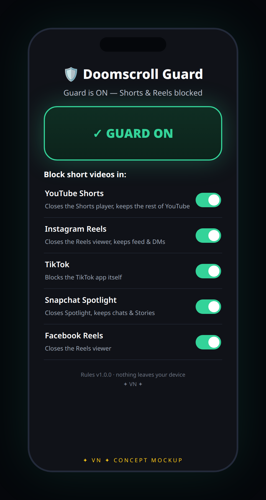

# 🛡️ Doomscroll Guard

**One switch. No more doomscrolling.** A free, open-source mobile app that removes
short-form video — YouTube Shorts, Instagram Reels, TikTok, Snapchat Spotlight,
Facebook Reels — with a single on/off switch. Android + iOS.

✦ VN ✦ — a Vivek Nair original. [Live landing page](https://vivekn4.github.io/doomscroll-guard/)


*↑ Concept mockup of the Android app UI. Rendered from the design spec — the app
has not yet been run on a physical device (see "What's validated" below).*

## What it does

- **One giant switch** — on: short-form video gets closed the moment it opens.
  Off: everything works normally.
- **Per-app toggles** in plain language — YouTube, Instagram, TikTok, Snapchat, Facebook.
- **Home-screen widget** (Android) — one tap on your home screen flips the Guard.
- **Quick Settings tile** (Android) — the same switch, one swipe away.
- **iOS stripped browser** — YouTube and Instagram without Shorts/Reels inside the app.
- **Zero accounts, zero servers, zero telemetry.** Nothing leaves your device. Ever.

## Honest capabilities — read this first

| Capability | Android | iOS |
|---|---|---|
| Remove Shorts/Reels **inside the native app** | ✅ Yes — detects the player and closes it | ❌ **Impossible.** Apple gives no app the power to inspect or change another app's interface |
| Keep DMs/feed while killing short-form | ✅ Yes | ⚠️ Only inside the app's stripped browser, not the native app |
| TikTok | ✅ Blocks the app (it's all short video) | ✅ Locks the app via Screen Time (same net effect) |
| Works with no special setup | ❌ You enable one system switch in Settings (guided, 30 sec) | ❌ Wrapper needs login in the in-app browser; app-lock needs Apple's entitlement |

**Plain-language limits:**
- **iOS cannot modify the native Instagram, YouTube, or TikTok apps.** On iPhone you get
  a stripped in-app browser plus optional whole-app Screen Time locks — never a
  Reels-tab-ectomy inside Instagram.app.
- **Android blocking depends on undocumented UI details** of YouTube/Instagram/etc.
  When those apps update their layouts, detection can miss until the rule bundle is
  updated (bundles update without an app release).
- **TikTok is all short-form.** The TikTok switch blocks the TikTok app itself.
- **Not tamper-proof.** Anyone with the device PIN can turn the permissions off.
  This is a friction tool for willing users, not parental-control software.
- **Setup needs permissions you grant manually:** Android → Accessibility (+ overlay
  for shield mode); iOS → Screen Time authorization (+ Apple's entitlement for locks).

## Install

### Android (V1 — primary)
1. Get the APK from **GitHub Releases** (or F-Droid once listed).
2. Open the app — the 3-step wizard walks you through: the plain-language disclosure
   (tap *I understand*), enabling the Guard in system Settings, done.
3. Long-press your home screen → **Widgets → Doomscroll Guard** for the one-tap switch.

### iOS
Build from source in Xcode — see [ios/README.md](ios/README.md) (5 steps).
**File the FamilyControls entitlement on day one** — [docs/entitlements.md](docs/entitlements.md).
Without it you still get the stripped browser + Safari Content Blocker.

## How it works

**Android:** a package-filtered `AccessibilityService` watches for short-form surfaces
(view IDs → text markers → layout corroboration, 600ms debounce) and closes them with
a back-action or a calm shield screen. Deterministic rules only — no AI agents, per
Play policy. See [docs/play-policy.md](docs/play-policy.md).

**iOS:** a WKWebView wrapper injects `shorts-stripper.js` (route rewrites, DOM removal,
MutationObserver re-cleanup); FamilyControls whole-app shields lock the native apps;
a Safari Content Blocker companion hides Shorts/Reels UI in Safari.

**Shared brain:** [`shared/rules/rules.json`](shared/rules/rules.json) — one versioned,
signed rule bundle (packages, view IDs, text markers, URL patterns, CSS selectors) used
by both apps. Validate before release:

```bash
python3 tools/validate_rules.py
```

## Repo layout

```
├── PLAN.md               # architecture, pitfalls, UI/UX, distribution (read first)
├── shared/rules/         # rules.json + schema.json — the shared detection bundle
├── tools/                # validate_rules.py
├── android/              # Kotlin app (V1): service, engine, UI, widget, QS tile
├── ios/                  # Swift app: wrapper, shields, extensions, Safari blocker
├── docs/                 # android-setup, ios-setup, entitlements, play-policy
└── index.html            # landing page (GitHub Pages)
```

## What's validated vs. what needs a device

**Validated here (no SDKs on this machine):**
- ✅ `shared/rules/rules.json` parses and passes `tools/validate_rules.py`
  (schema + regexes + ID uniqueness + intervention sanity — including a negative test
  proving the validator rejects bad bundles)
- ✅ File structure complete; docs written against the researched sources
- ✅ iOS API details spot-checked (ShieldActionResponse cases, ManagedSettingsStore
  signatures, entitlement flow)

**Needs on-device testing (honest list):**
- 🔲 Compile the Kotlin app (needs Android SDK) and the Swift app (needs Xcode)
- 🔲 Dump live accessibility trees (`adb shell uiautomator dump`) to re-verify every
  view ID in the rule bundle against current YouTube/Instagram/TikTok/Snapchat builds
- 🔲 Tune debounce/throttle; measure battery with Battery Historian
- 🔲 iOS: wrapper selector maintenance on live m.youtube.com / instagram.com
- 🔲 Apple FamilyControls entitlement approval (days–weeks, can be denied)
- 🔲 Google Play review (F-Droid/GitHub-first regardless)

## Contributing

Rule-bundle fixes are the highest-value contribution: app updated its UI and a view ID
rotted? Update `shared/rules/rules.json`, run the validator, open a PR. See
[docs/android-setup.md](docs/android-setup.md) for the re-verification flow.

## License

MIT — see [LICENSE](LICENSE). ✦ VN ✦
